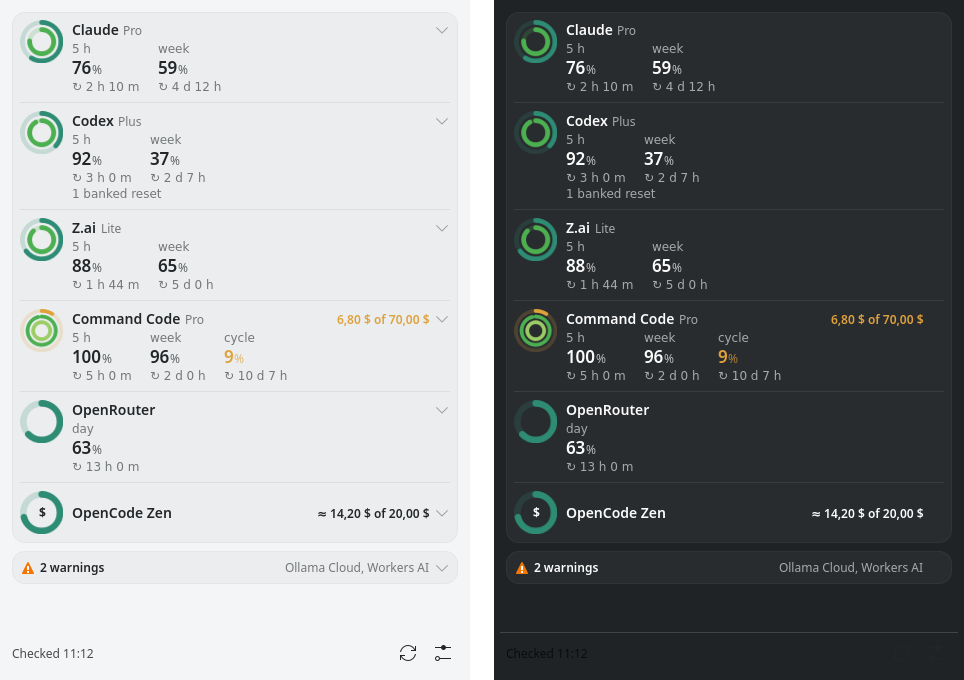

<p align="center">
  
</p>

<h1 align="center">Ataecina</h1>

<p align="center">
  <strong>See what is left of every AI subscription you pay for — and when each window is reborn.</strong><br>
  Claude, Codex, Z.ai, MiniMax, Command Code, OpenRouter, OpenCode Zen and more, on the Linux desktop,<br>
  without handing your sessions to anyone.
</p>

<p align="center">
  
  
  
  
</p>

**Current version:** `0.20.2-unstable` — early development: everything below
works on the maintainer's desktop; packages are built from source until the
first public release (see [docs/ROADMAP.md](docs/ROADMAP.md)).

<p align="center">
  
</p>

## Why

- **Every window at a glance.** The 5-hour, weekly and monthly windows of
  each plan, side by side, with what is *left* — not what you already used.
- **Know when it is reborn.** Every window shows its countdown to the reset,
  and a window that reset while nobody was looking is shown reborn.
- **Money too.** Prepaid balances and monthly credits show what is left of
  their total.
- **Problems stay out of the way.** A source that fails folds into a warning
  and a single desktop notification, instead of a wrong number.
- **Read-only, no sessions.** Ataecina never touches a login token, a
  cookie or a web console. Keys you give it are sealed at rest.
- **Native on Linux.** A KDE Plasma widget that lives in the system tray, a
  tray icon for other desktops, a terminal table and a JSON contract — one
  small static binary, nothing resident.

## What it shows

- **Growth rings** — one ring per window, the longest outside, filled with
  what is left: teal and greens while there is room, amber from 90 % used,
  coral from 95 %, grey and translucent when the figure is stale. Nothing
  is drawn for what is not known.
- **Every window** — `5 h`, `week`, `month` or `cycle`, each with the
  percentage left and `↻ 3 d 17 h` to the reset; click a row to unfold every
  bucket, the balance and the source's hint.
- **Balances** — `$6.80 of $70.00` when the total is known, `≈` when the
  figure is derived rather than reported.
- **Warnings** — subscriptions whose key is missing or rejected, or whose
  source answered something unexpected, fold under one line with the
  reason. Free providers without a plan appear only when they report
  free-model limits.
- **Alerts** — a desktop notification when a window crosses 90 % and 95 %
  (once per window), and once when a source starts failing.
- **Freshness and fidelity** — every figure knows when it was read and
  whether it was *reported* by the provider, *derived* locally, *observed*
  by a relay or *declared* by you.

## Supported subscriptions

| Subscription | What Ataecina reads | Source | Credential | Fidelity | Status |
|---|---|---|---|---|---|
| Claude (Pro, Max) | 5-hour and weekly windows | Claude Code status line hook | none | reported | verified |
| ChatGPT / Codex | 5-hour and weekly windows, credits, banked resets | Codex session logs; the official `codex app-server` when they are stale | none (Codex's own login) | reported | verified |
| Z.ai GLM Coding Plan | 5-hour and weekly token quotas | Z.ai quota API (undocumented) | API key | reported | verified |
| MiniMax Token Plan | 5-hour and weekly quotas | MiniMax `remains` API (undocumented) | API key | reported | verified |
| Command Code | 5-hour, weekly and monthly credits, money left | Command Code account API (alpha) | API key | reported | verified |
| OpenRouter | free-model requests per day, credits | OpenRouter API | API key | reported | verified |
| Vercel AI Gateway | credits left and spent | AI Gateway `/v1/credits` | API key | reported | verified |
| Orca Router | allowance left and spent | Orca Router billing API | API key | reported | verified |
| OpenCode Zen | balance left | your declared balance minus the cost `opencode stats` records | none | derived | verified |
| Ollama Cloud | session and weekly usage | ollama.com usage API (undocumented) | API key | reported | adapter needs a fix |
| Cloudflare Workers AI | neurons used today of the free 10 000 | Cloudflare GraphQL Analytics | analytics-only token + account id | reported | to verify |
| GitHub Copilot | premium requests or AI credits this month | official `gh api` billing report | `gh`'s own login | derived | to verify |
| Alibaba Model Studio Token Plan | 5-hour, weekly and monthly windows | official `bl usage token-plan` | `bl`'s own login | reported | to verify |
| Free tiers served by [Heimdall](https://codeberg.org/simplicer/heimdall) (Gemini keys, NVIDIA, Groq…) | cooldowns and resets observed while serving | Heimdall admin API on loopback | Heimdall admin token | observed | waits for Heimdall |
| Gemini CLI (Google account), Qwen Code (Qwen OAuth) | — | nothing readable without the tool's login token | — | — | unsupported |

*Verified* means read live with real accounts by the maintainer. Undocumented
endpoints may change without notice; when one does, only that subscription
turns into a warning. Every source, with its host, fields and the date it
was checked, is documented in [docs/SPECS.md](docs/SPECS.md) §3.

## How it works

```text
  official tools' local signals      official CLIs        provider APIs (your keys)
  Claude Code status line hook       codex app-server     Z.ai · MiniMax · OpenRouter…
  Codex session logs                 opencode · gh · bl          │
              │                            │                     │
              └──────────────┬─────────────┴─────────────────────┘
                             ▼
              ataecina collect  — one shot, every 5 minutes,
              hardened systemd user timer; the only part that
              unseals keys and opens network connections
                             │
                             ▼
              $XDG_RUNTIME_DIR/ataecina/snapshot.json  (figures only, RAM)
                             │
          ┌──────────────────┼──────────────────┬───────────────────┐
          ▼                  ▼                  ▼                   ▼
   Plasma widget        ataecina tray      ataecina status     desktop alerts
   (system tray)        (other desktops)   (table · --json)    (90 %, 95 %, failures)
```

1. **Sources, safest first.** For each subscription Ataecina uses the safest
   source there is: what the vendor's own tool already writes on your
   machine (the Claude Code status line, Codex's session logs), the vendor's
   official CLI with a fixed command line, and only then a provider API with
   an API key you give it.
2. **One-shot collector.** A systemd user timer runs `ataecina collect`
   every five minutes. It reads every subscription in parallel, isolates
   failures (one broken provider never breaks the others), writes a small
   snapshot of figures in RAM, raises alerts and exits.
3. **Displays only read.** The Plasma widget, the tray icon and the
   terminal read the snapshot through `ataecina status --json`; they never
   unseal a key or open a network connection.
4. **Time does the rest.** A figure older than its interval turns stale; a
   window past its reset is shown reborn until a new reading arrives.

## Read-only and private by design

- **No sessions, ever.** Ataecina never reads, refreshes or forwards OAuth
  tokens, session cookies or browser storage, never runs a vendor login and
  never scrapes a web console. Claude and Codex are read from what their own
  tools write; everything else uses an official CLI with its own login or an
  API key you choose to give.
- **Sealed keys.** Keys live in `~/.config/ataecina/keys.json`, each one
  encrypted with AES-256-GCM under a random master key; copying the file
  reveals nothing. The master key is held by an **unlocker**: the desktop's
  Secret Service (KWallet or GNOME Keyring, unlocked at login), a
  passphrase, or a TPM-bound systemd credential for headless machines.
- **Keys go in one way.** `ataecina keys set <name>` reads them without
  echo; on Plasma the widget's settings open KDE's masked dialog, which
  pipes the key straight to that command — the widget never sees it. Keys
  never appear in arguments, the environment, logs, the snapshot or errors.
- **Short leash on the network.** Each adapter reaches one fixed HTTPS
  host, follows no redirect, caps every answer at 64 KiB, makes one attempt
  and honours `Retry-After`. No telemetry, no analytics, no update checks.
- **Strict files.** Ataecina refuses to run if its configuration or key file
  is readable by anyone else, like ssh.

The rules are in [SECURITY.md](SECURITY.md) and the decisions behind them in
[docs/adrs/](docs/adrs/) (0003 to 0006, 0012, 0014).

## Install

No packages are published yet; build the one for your distribution from a
checkout (Go 1.27 and gettext's `msgfmt` needed). Packages are reproducible:
the same commit always gives byte-identical files.

| Distribution | Build | Install |
|---|---|---|
| Debian, Ubuntu, KDE neon, Kubuntu | `make deb` | `make install-deb` (or `sudo apt install ./dist/ataecina_*.deb`) |
| Fedora, openSUSE | `make package` | `sudo dnf install ./dist/ataecina-*.x86_64.rpm` |
| Arch, Manjaro, EndeavourOS | `make package`, or the `PKGBUILD` in `infra/packaging/arch/` | `sudo pacman -U dist/ataecina-*.pkg.tar.zst` |
| Anything else, or no root | `make install-user` | into `~/.local` (`make uninstall-user` removes it) |

Packages install the `ataecina` binary, the collector's systemd user units,
the Plasma widget, the icon, the tray launcher and the docs. Nothing is
enabled for you.

## Set up

```sh
ataecina init                                         # ~/.config/ataecina, 0700, and the master key
$EDITOR ~/.config/ataecina/config.json                # your subscriptions (see below)
systemctl --user enable --now ataecina-collect.timer  # collect every 5 minutes
ataecina doctor                                       # checks permissions, keyring, keys and sources
```

A configuration lists the subscriptions to follow; validation is strict and
unknown keys are errors. The full reference is in
[docs/SPECS.md](docs/SPECS.md) §9 and
[etc/ataecina.example.json](etc/ataecina.example.json):

```json
{
  "version": 1,
  "interval_minutes": 5,
  "alerts": { "thresholds": [90, 95] },
  "subscriptions": [
    { "id": "claude", "source": "claude-statusline", "plan": "PRO" },
    { "id": "codex", "source": "codex-logs", "app_server": true },
    { "id": "zai", "source": "zai-api" },
    { "id": "openrouter", "source": "openrouter-api" },
    { "id": "zen", "source": "opencode-zen" }
  ]
}
```

**API keys.** For each subscription that needs one, either type it in a
terminal or, on Plasma, use the widget's settings (right-click the widget,
"Configure Ataecina…", **Keys**, "Set key…"):

```sh
ataecina keys set zai          # paste the key; it is read without echo and sealed
```

**Claude Code.** Claude Code hands its rate limits to your status line
command; add one line to your status line script, right after it reads its
input — it is silent and runs in the background:

```sh
printf '%s' "$input" | ataecina hook claude-statusline &
```

or, without a status line of your own, let Ataecina be it:

```json
{ "statusLine": { "type": "command", "command": "ataecina hook claude-statusline --print" } }
```

Claude's figures refresh whenever Claude Code draws its status line.

**Codex.** Codex's figures come from its session logs; with
`"app_server": true` Ataecina also asks the official `codex app-server` when
the logs are older than an hour, so Codex stays fresh even when you do not
use it.

**OpenCode Zen.** Declare your balance once — from the widget's **Keys**
page ("Declare balance…") or a terminal — and Ataecina subtracts what
OpenCode records as spent:

```sh
ataecina balance declare zen --balance 20   # or --top-up 10 after adding money
```

**Headless machines.** Hold the master key with the TPM-bound systemd
credential so the timer needs no passphrase:

```sh
ataecina unlockers add systemd-creds && systemctl --user daemon-reload
```

## Use

**KDE Plasma.** Put the widget in the system tray — right-click the tray's
arrow, "Configure System Tray…", "Entries", **Ataecina**: "Always shown" —
or in a panel ("Add Widgets…"). Click the icon for the popup; middle-click,
or the ⟳ button, to collect now. The icon's ring shows what is left of the
window closest to running out.

**Other desktops** (XFCE, Cinnamon, MATE, LXQt, Budgie, Waybar, GNOME with
the AppIndicator extension): start **Ataecina** from the applications menu,
or `ataecina tray`. Its menu lists every subscription, "Refresh now" and
"Quit". To start it with your session:

```sh
mkdir -p ~/.config/autostart
cp /usr/share/applications/org.simplicer.ataecina.desktop ~/.config/autostart/
```

**Terminal and scripts.**

```text
ataecina [status] [--json]          the snapshot: a table, or the JSON contract
ataecina collect                    read every subscription now (what the timer runs)
ataecina hook claude-statusline     record the Claude limits Claude Code passes to its status line
ataecina balance declare            record a top-up or the balance of OpenCode Zen
ataecina init                       create ~/.config/ataecina and the master key
ataecina keys set|list|forget       manage sealed keys (set reads stdin without echo)
ataecina unlockers add|list|remove  manage how the master key is held
ataecina doctor                     check permissions, keyring, keys and sources
ataecina tray                       tray icon for any desktop, until Quit
ataecina version | help
```

`ataecina status --json` is a public, versioned contract
([docs/SPECS.md](docs/SPECS.md) §8.2): `snake_case` fields,
`UPPER_SNAKE_CASE` enums, RFC 3339 dates in UTC and money as
`{"amount": 6.8, "currency": "USD"}`, so status bars and scripts can rely
on it. The terminal table is for people and may change.

## Performance

Measured on the maintainer's desktop (x86-64, KDE Plasma 6.6, twelve
subscriptions):

| What | Figure |
|---|---|
| `ataecina status` (what the widget runs) | ~5 ms, ~8 MB peak memory |
| A full collection, twelve subscriptions | 1–1.5 s, mostly waiting for the network and the official CLIs |
| Resident processes | none: the collector exits; the widget lives inside Plasma |
| Binary | one static file, ~10 MB; the `.deb` is ~3.7 MB |

## How it is built

Ataecina is written in **Go** (1.27) with the standard library and one
dependency, `github.com/godbus/dbus/v5` for the session bus; the Plasma
widget is a few QML files. The code follows Domain-Driven Design with
vertical slices: each bounded context has its own domain, application
(one use case per file) and infrastructure layers, and depends on the
others only through their ports.

| Context | Owns |
|---|---|
| `allowances` | subscriptions, meters, balances, readings, fidelity, freshness, the snapshot; one adapter per source |
| `keys` | sealed keys, the master key and its unlockers |
| `alerts` | thresholds, alerts once per window, failing sources, notifications |

```text
cmd/ataecina/                    composition root: subcommands and wiring
internal/<context>/domain/       pure Go: entities, value objects, ports, errors
internal/<context>/application/  use cases (collect_readings.go, seal_key.go…)
internal/<context>/infrastructure/  adapters: providers, files, D-Bus, renderers
internal/platform/               shared technical pieces: hardened HTTP, XDG, logging
share/plasma/plasmoids/org.simplicer.ataecina/   the Plasma widget (QML, translations)
infra/systemd/  infra/packaging/                 user units; nfpm and PKGBUILD
docs/SPECS.md  docs/adrs/  docs/ROADMAP.md       specification, decisions, plan
```

Quality gates, all required before a change lands: unit tests with 100 %
coverage of every use case, integration tests against recorded and
sanitized provider answers, acceptance tests across contexts, end-to-end
tests of the built binary in a throw-away home, fuzzing of every provider
decoder, `go vet`, `govulncheck`, and static checks of the widget against
the JSON contract. The suite never calls a real provider and never touches
your keys or your home.

The rules every change follows are in [AGENTS.md](AGENTS.md), the
behaviour in [docs/SPECS.md](docs/SPECS.md), every architectural decision
in [docs/adrs/](docs/adrs/) and the plan in [docs/ROADMAP.md](docs/ROADMAP.md).

## Development

```sh
make            # build var/build/ataecina and stage the widget
make check      # format, vet, unit, coverage, integration, acceptance, benchmarks, widget, vulnerabilities, version
make e2e        # the built binary end to end against fake providers
make fuzz       # explore the provider decoders further (FUZZ_TIME=30s)
make package    # .deb, .rpm and Arch packages for amd64 and arm64, verified, with SHA256SUMS
make deb        # only this machine's .deb; make install-deb installs it with apt
```

After changing a string of the widget, regenerate its template and update
the Spanish translation:

```sh
cd share/plasma/plasmoids/org.simplicer.ataecina
xgettext --from-code=UTF-8 --language=JavaScript --kde \
  -ki18n:1 -ki18nc:1c,2 -ki18np:1,2 -ki18ncp:1c,2,3 \
  --package-name=plasma_applet_org.simplicer.ataecina \
  --msgid-bugs-address=https://codeberg.org/simplicer/ataecina \
  -o translate/template.pot contents/ui/*.qml contents/config/*.qml
msgmerge --update translate/es.po translate/template.pot
```

Releases sign `dist/SHA256SUMS` (`gpg --armor --detach-sign`); the AUR
`PKGBUILD` builds from the release tag. Versions follow Semantic Versioning:
`VERSION` is the single source of truth, every version is `0.Y.Z-unstable`
while the major is 0, and [CHANGELOG.md](CHANGELOG.md) records each one.
How to contribute is in [CONTRIBUTING.md](CONTRIBUTING.md); how to report a
vulnerability, in [SECURITY.md](SECURITY.md).

## About

Ataecina is designed and written by **Antonio Villamarín** (2026), as part
of [Simplicer](https://codeberg.org/simplicer), together with its sibling
project [Heimdall](https://codeberg.org/simplicer/heimdall), the model relay
that spends those quotas in the right order.

**The name.** Ataecina (also *Ataegina* or *Adaegina*) was a goddess of the
pre-Roman peoples of the west of the Iberian Peninsula, with her main
sanctuary at Turobriga, in today's province of Huelva, and altars in Mérida
and at Santa Lucía del Trampal, in Cáceres. She was the goddess of spring
and of rebirth — her name is usually read as the Celtic *ate-gena*, "the
reborn". That is the life of an AI quota: you spend it, it runs out, and it
is reborn at the next reset. Ataecina tells you how much is left and when.

## License

Copyright © 2026 Antonio Villamarín.

Ataecina is free software: you can redistribute it and/or modify it under
the terms of the GNU General Public License as published by the Free
Software Foundation, either version 3 of the License, or (at your option)
any later version. It is distributed in the hope that it will be useful,
but WITHOUT ANY WARRANTY; without even the implied warranty of
MERCHANTABILITY or FITNESS FOR A PARTICULAR PURPOSE. See [LICENSE](LICENSE)
for the full text.
