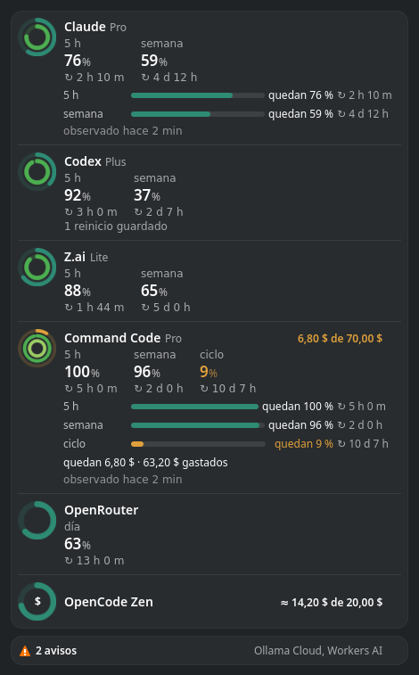
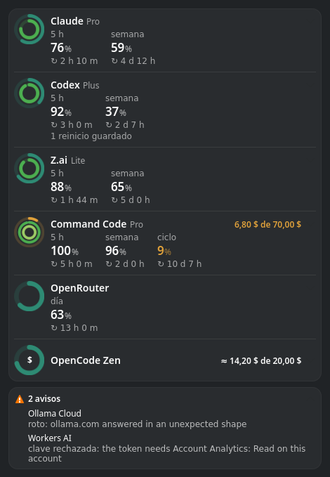
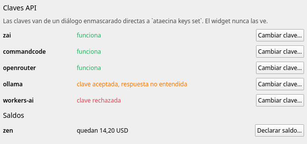
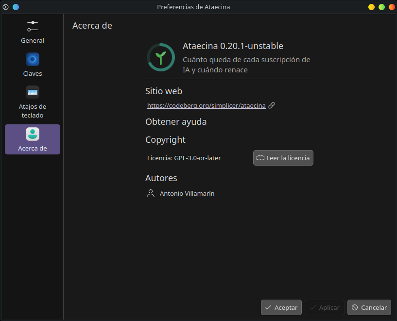

<p align="center">
  
</p>

<h1 align="center">Ataecina</h1>

<p align="center">
  <strong>See what is left of every AI subscription you pay for — and when each window is reborn.</strong><br>
  Claude, Codex, Z.ai, MiniMax, Command Code, OpenRouter, OpenCode Zen and more, on the Linux desktop,<br>
  without handing your sessions to anyone.
</p>

<p align="center">
  
  
  
  
</p>

**Current version:** `0.35.1-unstable` — early development: everything below
works on the maintainer's desktop; packages are built from source until the
first public release (see [docs/ROADMAP.md](docs/ROADMAP.md)).

<p align="center">
  
</p>

## Why

- **Every window at a glance.** The 5-hour, weekly and monthly windows of
  each plan, side by side, with what is *left* — not what you already used.
- **Know when it is reborn.** Every window shows its countdown to the reset,
  and a window that reset while nobody was looking is shown reborn.
- **Money too.** Prepaid balances and monthly credits show what is left of
  their total.
- **Problems stay out of the way.** A source that fails folds into a warning
  and a single desktop notification, instead of a wrong number.
- **Read-only, no sessions.** Ataecina never touches a login token, a
  cookie or a web console. Keys you give it are sealed at rest.
- **Native on Linux.** A KDE Plasma widget that lives in the system tray, a
  tray icon for other desktops, a terminal table and a JSON contract — one
  small static binary, nothing resident.

## What it shows

- **Growth rings** — one ring per window, the longest outside, filled with
  what is left: teal and greens while there is room, amber from 90 % used,
  coral from 95 %, grey and translucent when the figure is stale. Nothing
  is drawn for what is not known.
- **Every window** — `5 h`, `week`, `month` or `cycle`, each with the
  percentage left and `↻ 3 d 17 h` to the reset; click a row to unfold every
  bucket, the balance and the source's hint.
- **Balances** — `$6.80 of $70.00` when the total is known, `≈` when the
  figure is derived rather than reported, `$1.20 spent` while an OpenCode
  Zen balance is not declared yet.
- **Peak and off-peak hours** — for plans that charge less outside their
  peak hours (Z.ai, the Alibaba Token Plan, Claude's session window), the
  row is tinted while it is off-peak and says until when ("Off-peak until
  07:00 · half the credits", "Peak hours until 11:00"). A subscription
  with nothing left to use has its name in red.
- **Warnings** — subscriptions whose key is missing or rejected, or whose
  source answered something unexpected, fold under one line with the
  reason. Free providers without a plan appear only when they report
  free-model limits.
- **Models** — unfold a row to see how many models its plan or provider
  offers, which are free ("374 models · 16 free", or "7 models included"
  for a coding plan) and which came out in the last 30 days, from the
  public [models.dev](https://models.dev) catalogue, refreshed once a day.
  "Models you can use" lists every model you can use with what is left
  (only the free ones once a window or the money runs out), best first
  by the [Artificial Analysis](https://artificialanalysis.ai/)
  Intelligence Index, with its price per million tokens; "Update models"
  (or `ataecina update`) refreshes both.
- **Offers** — coding plan offers the maintainer publishes in
  [`data/offers.csv`](data/offers.csv), fetched by `ataecina update` and
  folded under the subscriptions; a click opens the offer. Some links are
  affiliate links, marked "Sponsored link": the maintainer may earn a
  commission when you buy through them, at no extra cost to you. Set
  `"offers": false` in `config.json` to never fetch them.
- **Alerts** — a desktop notification when a window crosses 90 % and 95 %
  (once per window), and once when a source starts failing.
- **Freshness and fidelity** — every figure knows when it was read and
  whether it was *reported* by the provider, *derived* locally, *observed*
  by a relay or *declared* by you.

## How it looks

The screenshots show the Spanish interface and made-up figures.

<table>
  <tr>
    <td width="50%"></td>
    <td width="50%"></td>
  </tr>
  <tr>
    <td><strong>Click a row</strong> to unfold every window — a bar of what is left, the countdown to its rebirth — and the balance, spent and left.</td>
    <td><strong>Warnings</strong> gather the sources that failed, each with its reason, out of the way of the figures that are right.</td>
  </tr>
  <tr>
    <td></td>
    <td></td>
  </tr>
  <tr>
    <td><strong>Keys</strong>, in the widget's settings: which keys work, which were rejected, and a masked dialog to set or replace one; the OpenCode Zen balance is declared here too.</td>
    <td><strong>About</strong>, in the widget's settings: version, website, license and author, as Plasma shows them.</td>
  </tr>
</table>

**Languages.** The Plasma widget, its settings and the desktop
notifications speak Spanish (the main language), Catalan, Basque,
Galician and English. By default they follow your desktop's language
(any other falls back to English); pick another in the widget's settings,
**General → Language**, and for notifications set `"language": "eu"` (or
`es`, `ca`, `gl`, `en`) in `config.json`. Numbers, money and percentages follow
each language's customs (`$6.80` and `63%` in English, `6,80 $` and
`63 %` in Spanish, Catalan and Galician, `%63` in Basque). The terminal
and the hints the sources write are in English. Translations are welcome
([CONTRIBUTING.md](CONTRIBUTING.md)).

## Supported subscriptions

| Subscription | What Ataecina reads | Source | Credential | Fidelity | Status |
|---|---|---|---|---|---|
| Claude (Pro, Max) | 5-hour and weekly windows | Claude Code status line hook | none | reported | verified |
| ChatGPT / Codex | 5-hour and weekly windows, credits, banked resets | Codex session logs; the official `codex app-server` when they are stale | none (Codex's own login) | reported | verified |
| Z.ai GLM Coding Plan | 5-hour and weekly token quotas | Z.ai quota API (undocumented) | API key | reported | verified |
| MiniMax Token Plan | 5-hour and weekly quotas | MiniMax `remains` API (undocumented) | API key | reported | verified |
| Command Code | 5-hour, weekly and monthly credits, money left | Command Code account API (alpha) | API key | reported | verified |
| OpenRouter | free-model requests per day, credits | OpenRouter API | API key | reported | verified |
| Vercel AI Gateway | credits left and spent | AI Gateway `/v1/credits` | API key | reported | verified |
| Orca Router | allowance left and spent | Orca Router billing API | API key | reported | verified |
| OpenCode Zen | balance left | your declared balance minus the cost `opencode stats` records | none | derived | verified |
| OpenCode Go, OpenCode Console budgets | rolling, weekly and monthly Go windows; what is left of each budget | official `opencode api experimental.usage.limits` | OpenCode's own sign-in to the Console | reported | to verify |
| Ollama Cloud | included credit left this period and its renewal (5-hour and weekly windows on legacy plans), purchased credit | ollama.com balance API | API key | reported | verified |
| Kimi Code (Plus, Pro, Max, Ultra) | 5-hour and weekly windows, plan | Kimi Code usage API (undocumented, used by the official CLI) | Kimi Code Console API key | reported | to verify |
| Moonshot AI (Kimi) open platform | prepaid balance (USD or CNY) | Moonshot balance API | platform API key | reported | to verify |
| xAI API (Grok) | prepaid credit left | xAI Management API | management key + team id | reported | to verify |
| Cursor Teams / Enterprise | your on-demand spending against your limit this cycle | Cursor Admin API | team Admin API key + your e-mail | reported | to verify |
| Kilo Gateway | credit left | Kilo balance API (undocumented) | API key | reported | to verify |
| Groq, NVIDIA (build.nvidia.com), Google AI Studio (Gemini API keys) | that the key works, and the models it offers (no allowance is published) | one free request only a valid key is answered | API key | — | verified |
| Cloudflare Workers AI | neurons used today of the free 10 000 | Cloudflare GraphQL Analytics | analytics-only token + account id | reported | to verify |
| GitHub Copilot | premium requests or AI credits this month | official `gh api` billing report | `gh`'s own login | derived | to verify |
| Alibaba Model Studio Token Plan | every window the plan reports (5-hour, weekly, monthly…) | official `bl usage token-plan` | `bl`'s own console login | reported | to verify |
| Alibaba Model Studio Coding Plan | 5-hour, weekly and monthly requests, plan | official `bl usage coding-plan` | `bl`'s own console login | reported | to verify |
| Free tiers served by a local Heimdall gateway (Gemini keys, NVIDIA, Groq…) | cooldowns and resets observed while serving | Heimdall admin API on loopback | Heimdall admin token | observed | waits for Heimdall |
| Gemini CLI (Google account), Qwen Code (Qwen OAuth) | — | nothing readable without the tool's login token | — | — | unsupported |
| Cursor individual plans, Windsurf, SuperGrok | — | usage only behind the dashboard's session; no API key or CLI gives it | — | — | unsupported |

*Verified* means read live with real accounts by the maintainer. Undocumented
endpoints may change without notice; when one does, only that subscription
turns into a warning. Every source, with its host, fields and the date it
was checked, is documented in [docs/SPECS.md](docs/SPECS.md) §3.

## How it works

```text
  official tools' local signals      official CLIs        provider APIs (your keys)
  Claude Code status line hook       codex app-server     Z.ai · MiniMax · OpenRouter…
  Codex session logs                 opencode · gh · bl          │
              │                            │                     │
              └──────────────┬─────────────┴─────────────────────┘
                             ▼
              ataecina collect  — one shot, every 5 minutes,
              hardened systemd user timer; the only part that
              unseals keys and opens network connections
                             │
                             ▼
              $XDG_RUNTIME_DIR/ataecina/snapshot.json  (figures only, RAM)
                             │
          ┌──────────────────┼──────────────────┬───────────────────┐
          ▼                  ▼                  ▼                   ▼
   Plasma widget        ataecina tray      ataecina status     desktop alerts
   (system tray)        (other desktops)   (table · --json)    (90 %, 95 %, failures)
```

1. **Sources, safest first.** For each subscription Ataecina uses the safest
   source there is: what the vendor's own tool already writes on your
   machine (the Claude Code status line, Codex's session logs), the vendor's
   official CLI with a fixed command line, and only then a provider API with
   an API key you give it.
2. **One-shot collector.** A systemd user timer runs `ataecina collect`
   every five minutes. It reads every subscription in parallel, isolates
   failures (one broken provider never breaks the others), writes a small
   snapshot of figures in RAM, raises alerts and exits.
3. **Displays only read.** The Plasma widget, the tray icon and the
   terminal read the snapshot through `ataecina status --json`; they never
   unseal a key or open a network connection.
4. **Time does the rest.** A figure older than its interval turns stale; a
   window past its reset is shown reborn until a new reading arrives.

## Read-only and private by design

- **No sessions, ever.** Ataecina never reads, refreshes or forwards OAuth
  tokens, session cookies or browser storage, never runs a vendor login and
  never scrapes a web console. Claude and Codex are read from what their own
  tools write; everything else uses an official CLI with its own login or an
  API key you choose to give.
- **Sealed keys.** Keys live in `~/.config/ataecina/keys.json`, each one
  encrypted with AES-256-GCM under a random master key; copying the file
  reveals nothing. The master key is held by an **unlocker**: the desktop's
  Secret Service (KWallet or GNOME Keyring, unlocked at login), a
  passphrase, or a TPM-bound systemd credential for headless machines.
- **Keys go in one way.** `ataecina keys set <name>` reads them without
  echo; on Plasma the widget's settings open KDE's masked dialog, which
  pipes the key straight to that command — the widget never sees it. Keys
  never appear in arguments, the environment, logs, the snapshot or errors.
- **Short leash on the network.** Each adapter reaches one fixed HTTPS
  host, follows no redirect, caps every answer at 64 KiB, makes one attempt
  and honours `Retry-After`. The only other host is the public model
  catalogue `models.dev`, asked at most once a day, revalidated with its
  ETag and never sent a key, and Artificial Analysis, only when you run
  `ataecina update` with your own free key; the same command reads the
  published offers from Codeberg (which then sees your address, like any
  download). No telemetry, no analytics, no update checks.
- **Strict files.** Ataecina refuses to run if its configuration or key file
  is readable by anyone else, like ssh.

The rules are in [SECURITY.md](SECURITY.md) and the decisions behind them in
[docs/adrs/](docs/adrs/) (0003 to 0006, 0012, 0014 to 0017).

## Install

**Download the package for your system** from the releases page — on
[Codeberg](https://codeberg.org/simplicer/ataecina/releases) or its
[GitHub mirror](https://github.com/simplicer/ataecina/releases) — and install
it. Nothing has to be built. Versions 0.x are published as pre-releases:
they work, and may still change.

| System | File (`amd64`; `arm64`/`aarch64` for ARM) | Install |
|---|---|---|
| Debian, Ubuntu, KDE neon, Kubuntu | `ataecina_<version>_amd64.deb` | `sudo apt install ./ataecina_*.deb`, or open it with Discover |
| Fedora, openSUSE | `ataecina-<version>.x86_64.rpm` | `sudo dnf install ./ataecina-*.rpm` (`sudo zypper install` on openSUSE) |
| Arch, Manjaro, EndeavourOS | `ataecina-<version>-x86_64.pkg.tar.zst` | `sudo pacman -U ataecina-*.pkg.tar.zst` |
| Any other Linux, or without root | `ataecina-<version>-linux-amd64.tar.gz` | `tar xf ataecina-*.tar.gz`, then `ataecina-*/install` (into `~/.local`; `--uninstall` removes it) |

`SHA256SUMS` beside them checks a download:
`sha256sum --check --ignore-missing SHA256SUMS`. Then reload the shell on
Plasma (step 3 below) and follow [First set-up, step by
step](#first-set-up-step-by-step).

### Build it yourself

You can also build the package for your distribution from the source,
which takes a minute. Packages are reproducible — the same commit always
gives byte-identical files, so you can check that a download is the code
you read.

**1. Get the tools and the source.** Go (1.21 or newer: it fetches the
exact toolchain the project pins by itself), `make`, `git` and gettext (for
`msgfmt`, which compiles the widget's translations):

```sh
sudo apt install golang make git gettext        # Debian, Ubuntu, KDE neon, Kubuntu
sudo dnf install golang make git gettext        # Fedora
sudo pacman -S go make git gettext              # Arch, Manjaro, EndeavourOS

git clone https://codeberg.org/simplicer/ataecina.git
cd ataecina
```

**2. Build and install the package for your system.**

| Distribution | Build | Install |
|---|---|---|
| Debian, Ubuntu, KDE neon, Kubuntu | `make deb` | `make install-deb` (runs `sudo apt install` on the package it built; without a terminal it asks through the desktop's password dialog) |
| Fedora, openSUSE | `make package` | `sudo dnf install ./dist/ataecina-*.x86_64.rpm` |
| Arch, Manjaro, EndeavourOS | `make package`, or the `PKGBUILD` in `infra/packaging/arch/` | `sudo pacman -U dist/ataecina-*.pkg.tar.zst` |
| Anything else, or no root | `make install-user` | installs into `~/.local`, then `systemctl --user daemon-reload`; `make uninstall-user` removes it |

A package installs the `ataecina` command, the collector's systemd user
units, the Plasma widget, the icon, the tray launcher for other desktops
and the documentation. Nothing is enabled or configured for you.

**3. On Plasma, reload the shell** so it sees the new widget:

```sh
systemctl --user restart plasma-plasmashell
```

## First set-up, step by step

**1. Create the configuration and the master key.**

```sh
ataecina init
```

This creates `~/.config/ataecina/` (only you can read it) and a random
master key that seals your API keys. On a desktop session the master key
goes into your keyring (KWallet or GNOME Keyring), unlocked when you log
in; without one, `ataecina init --unlocker passphrase` asks for a
passphrase instead.

**2. Add your subscriptions.** On Plasma, the easiest way is the widget's
settings: right-click the widget, **Configure Ataecina… → Subscriptions**,
pick the source, keep or change the suggested id and fill in what that
source asks for. In a terminal:

```sh
ataecina sources                                   # every source and what it needs
ataecina subscriptions add zai --source zai-api
ataecina subscriptions add minimax --source minimax-api
ataecina subscriptions add minimax-2 --source minimax-api   # a second plan of the same provider
ataecina subscriptions add copilot --source copilot-gh --set login=octocat --set monthly_allowance=300
ataecina subscriptions                             # what you have
```

Pick the source from the table in [Supported subscriptions](#supported-subscriptions).
Two subscriptions of the same provider are simply two ids, each with its
own key.

**3. Seal the API keys.** For each subscription whose source needs a key —
the widget's **Keys** page, "Set key…", opens a masked dialog; or in a
terminal, where the key is read without echo:

```sh
ataecina keys set zai          # paste the key, then Enter
ataecina keys set minimax-2    # the key name is the subscription id
```

Keys are encrypted at once and never shown again; `ataecina keys list`
shows their names and dates only.

**4. Start the collector.** It reads every subscription every five minutes:

```sh
systemctl --user enable --now ataecina-collect.timer
ataecina doctor                # checks permissions, keyring, keys and every source
```

**5. Show it.** On **KDE Plasma**, put the widget in the system tray —
right-click the tray's arrow, **Configure System Tray… → Entries →
Ataecina: Always shown** — or in a panel (**Add Widgets…**). On **other
desktops** (XFCE, Cinnamon, MATE, LXQt, Budgie, Waybar, GNOME with the
AppIndicator extension), start **Ataecina** from the applications menu or
run `ataecina tray`; to start it with your session:

```sh
mkdir -p ~/.config/autostart
cp /usr/share/applications/org.simplicer.ataecina.desktop ~/.config/autostart/
```

**6. Optional extras.**

- **Claude Code.** Claude Code hands its rate limits to your status line
  command. Add one line to your status line script, right after it reads
  its input (it is silent and runs in the background):

  ```sh
  printf '%s' "$input" | ataecina hook claude-statusline &
  ```

  or, without a status line of your own, let Ataecina be it, in
  `~/.claude/settings.json`:

  ```json
  { "statusLine": { "type": "command", "command": "ataecina hook claude-statusline --print" } }
  ```

- **Codex.** Its figures come from its session logs. Add
  `"app_server": true` to the Codex subscription so that Ataecina also asks
  the official `codex app-server` when the logs are older than an hour.
- **OpenCode Zen.** Declare your balance once — the widget's **Keys** page,
  "Declare balance…", or `ataecina balance declare zen --balance 20` (or
  `--top-up 10` after adding money) — and Ataecina subtracts what OpenCode
  records as spent.
- **OpenCode Go.** Add a subscription with the `opencode-console` source and
  sign OpenCode in to OpenCode Console once (`opencode auth login`).
- **Alibaba Model Studio.** Install Alibaba's official `bl` CLI and sign it
  in once (`bl auth login --console`); the plan's API key alone cannot read
  the quota.
- **Intelligence index.** For the ranking of each subscription's models, get
  a free key at [artificialanalysis.ai](https://artificialanalysis.ai/) and
  seal it with `ataecina keys set artificial-analysis`. Without it, an
  OpenRouter subscription is enough: the same index comes through
  OpenRouter, for fewer models.
- **Headless machines.** Hold the master key with a TPM-bound systemd
  credential, so the timer needs no passphrase:

  ```sh
  ataecina unlockers add systemd-creds && systemctl --user daemon-reload
  ```

## Use

**The widget.** Click the icon for the popup. Each subscription shows its
rings and, for every window (5 h, week, month, cycle), what is left and when
it is reborn; click a row to unfold every window, the balance, the source's
hint and **Models you can use**: the models you can use with what is left,
best first by intelligence, with their price per million tokens. **Update
models** refreshes the model catalogue and the intelligence index. Failing
sources fold under the **warnings** line, and coding plan **offers**, when
there are any, fold under it too; a click opens an offer. ⟳ (or a
middle-click on the icon) collects now. The icon's ring shows what is left
of the window closest to running out.

**The widget's settings** (right-click, **Configure Ataecina…**):

| Page | What it does |
|---|---|
| General | **Language** (the desktop's, Español, Català, Euskara, Galego, English), the command, how often to read, the figure in the panel, which subscriptions to show and in what order |
| Subscriptions | add and remove subscriptions |
| Keys | set or replace each key, declare the OpenCode Zen balance, set the Artificial Analysis key |

**The terminal.**

| Command | What it does |
|---|---|
| `ataecina` or `ataecina status [--json]` | the snapshot: a table, or the JSON contract |
| `ataecina collect` | read every subscription now (what the timer runs) |
| `ataecina models [--all] [--json] [<id>]` | each subscription's models, best first, and which you can use now |
| `ataecina update` | refresh now the model catalogue, the intelligence index and the offers |
| `ataecina offers [--json]` | the current coding plan offers |
| `ataecina subscriptions [--json]` | your subscriptions; `add <id> --source <source> [--plan <p>] [--key <name>] [--set <option>=<value>]…`, `remove <id>` |
| `ataecina sources [--json]` | every source Ataecina reads and the options it needs |
| `ataecina keys set <name>` / `list` / `forget <name>` | seal a key read from stdin without echo, list names, forget one |
| `ataecina balance declare <id> --balance <n>` / `--top-up <n>` | the OpenCode Zen balance |
| `ataecina unlockers list` / `add <kind>` / `remove <kind>` | how the master key is held: `secret-service`, `passphrase`, `systemd-creds` |
| `ataecina doctor` | check permissions, configuration, keyring, keys and sources |
| `ataecina hook claude-statusline [--print]` | record Claude Code's limits from its status line |
| `ataecina tray` | the tray icon for any desktop, until Quit |
| `ataecina init`, `version`, `help` | set up, version, help |

Commands that unlock the master key accept `--passphrase-fd <n>` to read a
passphrase from a file descriptor instead of the terminal.

`ataecina status --json` is a public, versioned contract
([docs/SPECS.md](docs/SPECS.md) §8.2): `snake_case` fields,
`UPPER_SNAKE_CASE` enums, RFC 3339 dates in UTC and money as
`{"amount": 6.8, "currency": "USD"}`, so status bars and scripts can rely
on it. The terminal table is for people and may change.

**The configuration file.** `~/.config/ataecina/config.json` (mode `0600`)
is written by `ataecina subscriptions` and the widget, and can be edited by
hand; validation is strict and unknown keys are errors. The full reference
is [docs/SPECS.md](docs/SPECS.md) §9; an example is
[etc/ataecina.example.json](etc/ataecina.example.json):

```json
{
  "version": 1,
  "interval_minutes": 5,
  "alerts": { "thresholds": [90, 95] },
  "language": "es",
  "offers": true,
  "subscriptions": [
    { "id": "claude", "source": "claude-statusline", "plan": "PRO" },
    { "id": "codex", "source": "codex-logs", "app_server": true },
    { "id": "zai", "source": "zai-api" },
    { "id": "openrouter", "source": "openrouter-api" },
    { "id": "zen", "source": "opencode-zen" }
  ]
}
```

`alerts.thresholds` are the percentages used at which a desktop notification
is sent (once per window); `language` sets the notifications' language;
`"offers": false` keeps `ataecina update` from fetching offers.

## Update and uninstall

**Update.** Pull and build again, then reinstall the package and reload the
shell; your configuration, keys and history stay:

```sh
cd ataecina && git pull
make deb && make install-deb          # or make package / make install-user
systemctl --user restart plasma-plasmashell
```

**Uninstall.** Remove the package (`sudo apt remove ataecina`,
`sudo dnf remove ataecina`, `sudo pacman -R ataecina`) or run
`make uninstall-user`. Your data stays until you delete it:
`~/.config/ataecina/` (configuration and sealed keys),
`~/.local/state/ataecina/` (alerts, declared balances, catalogues, log)
and the master key in your keyring (`ataecina unlockers remove
secret-service` before uninstalling).

## Troubleshooting

| What you see | What to do |
|---|---|
| The widget says "No snapshot yet" | `systemctl --user enable --now ataecina-collect.timer`, or `ataecina collect` once |
| The widget does not appear after installing | `systemctl --user restart plasma-plasmashell` |
| A subscription is under **warnings** with "key missing" or "key rejected" | set the key again (**Keys** page or `ataecina keys set <id>`); a rejected key may also lack a permission, which the hint names |
| "… is not on PATH" (`opencode`, `gh`, `bl`, `codex`) | the collector runs with a short `PATH`; install the tool in `~/.local/bin` or add a drop-in to `ataecina-collect.service` |
| Anything else | `ataecina doctor`, then the log: `~/.local/state/ataecina/ataecina.log` |

## Performance

Measured on the maintainer's desktop (x86-64, KDE Plasma 6.6, eleven
subscriptions):

| What | Figure |
|---|---|
| `ataecina status` (what the widget runs) | ~5 ms, ~8 MB peak memory |
| A full collection, eleven subscriptions | ~0.9 s and ~50 MB peak (the whole service, as systemd counts it) |
| …when OpenCode Zen's spend must be read again | ~1 s and ~135 MB peak for that second: `opencode stats` starts a whole OpenCode server |
| Resident processes | none: the collector exits; the widget lives inside Plasma |
| Binary | one static file, ~10 MB; the `.deb` is ~3.7 MB |

## How it is built

Ataecina is written in **Go** (1.27) with the standard library and one
dependency, `github.com/godbus/dbus/v5` for the session bus; the Plasma
widget is a few QML files. The code follows Domain-Driven Design with
vertical slices: each bounded context has its own domain, application
(one use case per file) and infrastructure layers, and depends on the
others only through their ports.

| Context | Owns |
|---|---|
| `allowances` | subscriptions, meters, balances, readings, fidelity, freshness, the snapshot; one adapter per source |
| `keys` | sealed keys, the master key and its unlockers |
| `alerts` | thresholds, alerts once per window, failing sources, notifications |
| `offerings` | the daily model catalogue: models per provider, prices, free and new ones |

```text
cmd/ataecina/                    composition root: subcommands and wiring
internal/<context>/domain/       pure Go: entities, value objects, ports, errors
internal/<context>/application/  use cases (collect_readings.go, seal_key.go…)
internal/<context>/infrastructure/  adapters: providers, files, D-Bus, renderers
internal/platform/               shared technical pieces: hardened HTTP, XDG, logging
share/plasma/plasmoids/org.simplicer.ataecina/   the Plasma widget (QML, translations)
infra/systemd/  infra/packaging/                 user units; nfpm and PKGBUILD
docs/SPECS.md  docs/adrs/  docs/ROADMAP.md       specification, decisions, plan
```

Quality gates, all required before a change lands: unit tests with 100 %
coverage of every use case, integration tests against recorded and
sanitized provider answers, acceptance tests across contexts, end-to-end
tests of the built binary in a throw-away home, fuzzing of every provider
decoder, `go vet`, `govulncheck`, and static checks of the widget against
the JSON contract. The suite never calls a real provider and never touches
your keys or your home.

The rules every change follows are in [AGENTS.md](AGENTS.md), the
behaviour in [docs/SPECS.md](docs/SPECS.md), every architectural decision
in [docs/adrs/](docs/adrs/) and the plan in [docs/ROADMAP.md](docs/ROADMAP.md).

## Development

```sh
make            # build var/build/ataecina and stage the widget
make check      # format, vet, unit, coverage, integration, acceptance, benchmarks, widget, vulnerabilities, version
make e2e        # the built binary end to end against fake providers
make fuzz       # explore the provider decoders further (FUZZ_TIME=30s)
make package    # .deb, .rpm and Arch packages for amd64 and arm64, verified, with SHA256SUMS
make deb        # only this machine's .deb; make install-deb installs it with apt
```

After changing a string of the widget, regenerate its template and update
every translation (`es`, `ca`, `eu`, `gl`):

```sh
cd share/plasma/plasmoids/org.simplicer.ataecina
xgettext --from-code=UTF-8 --language=JavaScript --kde \
  -ki18n:1 -ki18nc:1c,2 -ki18np:1,2 -ki18ncp:1c,2,3 \
  --package-name=plasma_applet_org.simplicer.ataecina \
  --msgid-bugs-address=https://codeberg.org/simplicer/ataecina \
  -o translate/template.pot contents/ui/*.qml contents/config/*.qml
for po in translate/*.po; do msgmerge --update --no-fuzzy-matching "$po" translate/template.pot; done
cd - && go run ./cmd/widget-translations   # the table the Language setting reads
```

Releases sign `dist/SHA256SUMS` (`gpg --armor --detach-sign`); the AUR
`PKGBUILD` builds from the release tag. Versions follow Semantic Versioning:
`VERSION` is the single source of truth, every version is `0.Y.Z-unstable`
while the major is 0, and [CHANGELOG.md](CHANGELOG.md) records each one.
How to contribute is in [CONTRIBUTING.md](CONTRIBUTING.md); how to report a
vulnerability, in [SECURITY.md](SECURITY.md).

## About

Ataecina is designed and written by **Antonio Villamarín** (2026), as part
of [Simplicer](https://codeberg.org/simplicer).

**The name.** Ataecina (also *Ataegina* or *Adaegina*) was a goddess of the
pre-Roman peoples of the west of the Iberian Peninsula, with her main
sanctuary at Turobriga, in today's province of Huelva, and altars in Mérida
and at Santa Lucía del Trampal, in Cáceres. She was the goddess of spring
and of rebirth — her name is usually read as the Celtic *ate-gena*, "the
reborn". That is the life of an AI quota: you spend it, it runs out, and it
is reborn at the next reset. Ataecina tells you how much is left and when.

## License

Copyright © 2026 Antonio Villamarín.

Ataecina is free software: you can redistribute it and/or modify it under
the terms of the GNU General Public License as published by the Free
Software Foundation, either version 3 of the License, or (at your option)
any later version. It is distributed in the hope that it will be useful,
but WITHOUT ANY WARRANTY; without even the implied warranty of
MERCHANTABILITY or FITNESS FOR A PARTICULAR PURPOSE. See [LICENSE](LICENSE)
for the full text.
